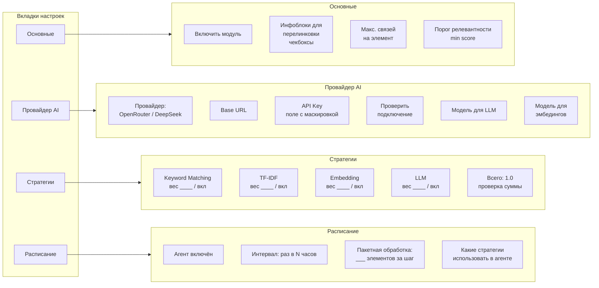
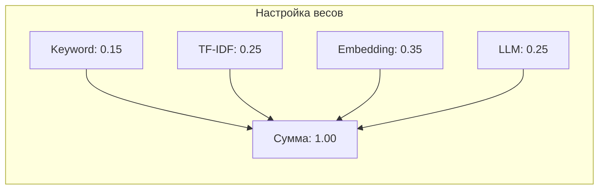
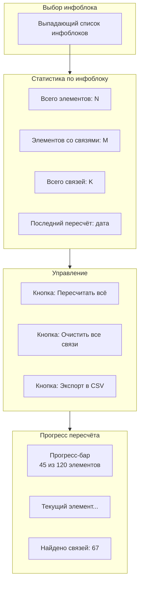
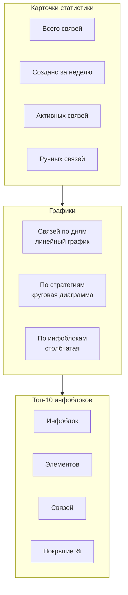

# Интерфейс админки модуля перелинковки

## Структура страниц

```
/admin/
├── perelinkovka_list.php          # Главная: список связей
├── perelinkovka_settings.php      # Настройки модуля
├── perelinkovka_iblock.php        # Перелинковка конкретного инфоблока
├── perelinkovka_stat.php          # Статистика и отчёты
├── menu.php                       # Пункты меню модуля
```

Доступ через меню Битрикс: **Сервис → Перелинковка** и подпункты.

---

## 1. Главная: список связей

**Файл:** [`admin/perelinkovka_list.php`](bauer.perelinkovka/admin/perelinkovka_list.php)

```mermaid
flowchart TB
    subgraph Page [Страница списка связей]
        F1[Фильтр: инфоблок]
        F2[Фильтр: тип сущности<br/>элемент/раздел]
        F3[Фильтр: стратегия<br/>keyword/tfidf/embedding/llm/manual]
        F4[Фильтр: активность]
        F5[Поиск по названию]
    end

    subgraph Table [Таблица связей]
        T1[ID связи]
        T2[Откуда: тип/ID/название]
        T3[Куда: тип/ID/название]
        T4[Стратегия]
        T5[Вес/Score]
        T6[Тип связи]
        T7[Сортировка]
        T8[Активность]
        T9[Действия]
    end

**Колонки таблицы:**

| Колонка | Тип | Что показывает | Пример |
|---------|-----|----------------|--------|
| **ID** | число | ID связи в БД | `1` |
| **Откуда** | ссылка | Тип + ID + название источника | `Элемент #1: iPhone 15 Pro` → ссылка на страницу товара |
| **Куда** | ссылка | Тип + ID + название цели | `Элемент #7: AirPods Pro 2` → ссылка на страницу товара |
| **Стратегия** | текст/badge | Каким алгоритмом создана | `keyword` (зелёный), `embedding` (синий), `manual` (оранжевый) |
| **Score** | число 0-1 | Оценка релевантности | `0.85` |
| **Тип** | badge | strong/medium/weak/manual | `strong` 🟢, `medium` 🟡, `weak` 🔴, `manual` 🔵 |
| **Сортировка** | число, editable | Порядок вывода на сайте | `100` (можно изменить прямо в ячейке) |
| **Активность** | иконка | Вкл/выкл показ на сайте | ✅ зелёный / ❌ красный |

    subgraph Actions [Действия]
        A1[Редактировать]
        A2[Удалить]
        A3[Деактивировать]
        A4[Добавить вручную]
    end

    F1 --> Table
    F2 --> Table
    F3 --> Table
    F4 --> Table
    F5 --> Table
    Table --> A1
    Table --> A2
    Table --> A3
    A4 --> Table
```

**Реализация через стандартные компоненты Битрикс:**

| Компонент | Что делает |
|-----------|-----------|
| `CAdminFilter` | Фильтр: инфоблок, тип сущности, стратегия, активность, поиск |
| `CAdminList` | Таблица: ID, откуда, куда, стратегия, score, сортировка, активность, действия |
| `CAdminList::AddGroupActionTable` | Bulk: деактивировать, удалить, активировать |
| `CAdminList::AddAdminContextMenu` | Кнопка "Добавить связь" |

**Данные для фильтра:**
- Инфоблок — select из `CIBlock::GetList`
- Тип сущности — select с fixed: `элемент`, `раздел`
- Стратегия — select с fixed: `keyword`, `tfidf`, `embedding`, `llm`, `manual`
- Активность — select: `все`, `да`, `нет`
- Поиск — текстовое поле, ищет по названиям через LIKE

**Добавление связи вручную:**
- Модалка на чистом JS Битрикс (`BX.CDialog`)
- Поиск сущностей через AJAX: `CIBlockElement::GetList` / `CIBlockSection::GetList` с автодополнением
- POST-запрос на сохранение в `b_bauer_perelinkovka_links`

---

## 2. Настройки модуля

**Файл:** [`admin/perelinkovka_settings.php`](bauer.perelinkovka/admin/perelinkovka_settings.php)



### 2.1. Основные настройки

| Поле | Тип | Описание |
|------|-----|----------|
| Включить модуль | checkbox | Глобальное вкл/выкл |
| Инфоблоки | checklist | Выбор инфоблоков для перелинковки |
| Макс. связей | number | Лимит на элемент (по умолч. 10) |
| Порог релевантности | slider 0.0-1.0 | Минимальный score для создания связи |

### 2.2. Провайдер AI

| Поле | Тип | Описание |
|------|-----|----------|
| Провайдер | select | OpenRouter / DeepSeek |
| Base URL | text | Например `https://openrouter.ai/api/v1` |
| API Key | password | С маскировкой, кнопка "Показать" |
| Модель LLM | select | deepseek-chat / deepseek-r1 / deepseek-r1-distill |
| Модель эмбедингов | select | text-embedding-3-small / text-embedding-ada-002 |
| Проверить подключение | button | Тестовый запрос к API |

### 2.3. Веса стратегий



- 4 ползунка (0.0 - 1.0, шаг 0.05)
- Автоматический пересчёт суммы
- Если сумма != 1.0 — предупреждение
- Чекбокс "выключить" для каждой стратегии

---

## 3. Перелинковка инфоблока

**Файл:** [`admin/perelinkovka_iblock.php`](bauer.perelinkovka/admin/perelinkovka_iblock.php)



**Кнопка "Пересчитать всё":**
1. AJAX-запрос на агента
2. Прогресс-бар с websocket/polling
3. Отмена операции
4. Лог: какие связи созданы/удалены

**Кнопка "Экспорт CSV":**
```
source_type,source_id,source_name,target_type,target_id,target_name,strategy,score
element,1,iPhone 15 Pro,element,7,AirPods Pro 2,keyword,0.85
element,1,iPhone 15 Pro,element,8,Чехол для iPhone,embedding,0.72
```

---

## 4. Статистика

**Файл:** [`admin/perelinkovka_stat.php`](bauer.perelinkovka/admin/perelinkovka_stat.php)



**Пример данных для графиков:**
```javascript
// Связей по дням
{
  labels: ['01.07', '02.07', '03.07', ...],
  datasets: [{ label: 'Создано', data: [5, 12, 8, ...] }]
}

// По стратегиям
{
  labels: ['Keyword', 'TF-IDF', 'Embedding', 'LLM', 'Manual'],
  data: [45, 120, 67, 23, 15]
}
```

Графики можно реализовать через:
1. **Chart.js** — подключить CDN в админке
2. **Google Charts** — бесплатно
3. **Свои SVG** — минималистично

---

## 5. UI/UX детали

### Цветовая схема типов связей

| Тип | Цвет | Значок |
|-----|------|--------|
| strong | 🟢 зелёный | score >= 0.7 |
| medium | 🟡 жёлтый | score 0.4-0.7 |
| weak | 🔴 красный | score < 0.4 |
| manual | 🔵 синий | создана вручную |

### Нотификации

- После пересчёта: `✅ Создано 45 связей, пропущено 12 дубликатов`
- Ошибка API: `❌ OpenRouter недоступен, использован fallback на Keyword + TF-IDF`
- Предупреждение: `⚠️ Сумма весов стратегий != 1.0`

### Mobile-friendly

- Таблицы с горизонтальным скроллом на мобильных
- Кнопки действий — иконки вместо текста на узких экранах
- Фильтры — выпадающие списки

---

## 6. Пути к файлам в модуле

```
/admin/
├── perelinkovka_list.php          # список связей
├── perelinkovka_settings.php      # настройки
├── perelinkovka_iblock.php        # управление инфоблоком
├── perelinkovka_stat.php          # статистика
├── menu.php                       # меню

/lang/ru/admin/
├── perelinkovka_list.php          # языковые фразы
├── perelinkovka_settings.php
├── perelinkovka_iblock.php
├── perelinkovka_stat.php
├── menu.php

/install/
├── index.php                      # установщик модуля
├── step.php                       # пошаговая установка
├── unstep.php                     # удаление
```
