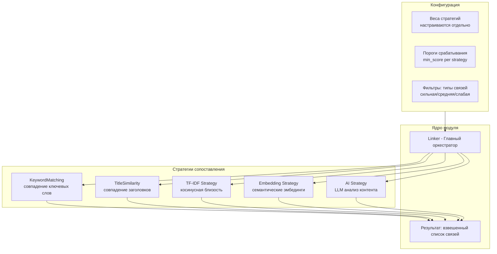
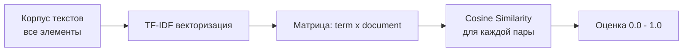
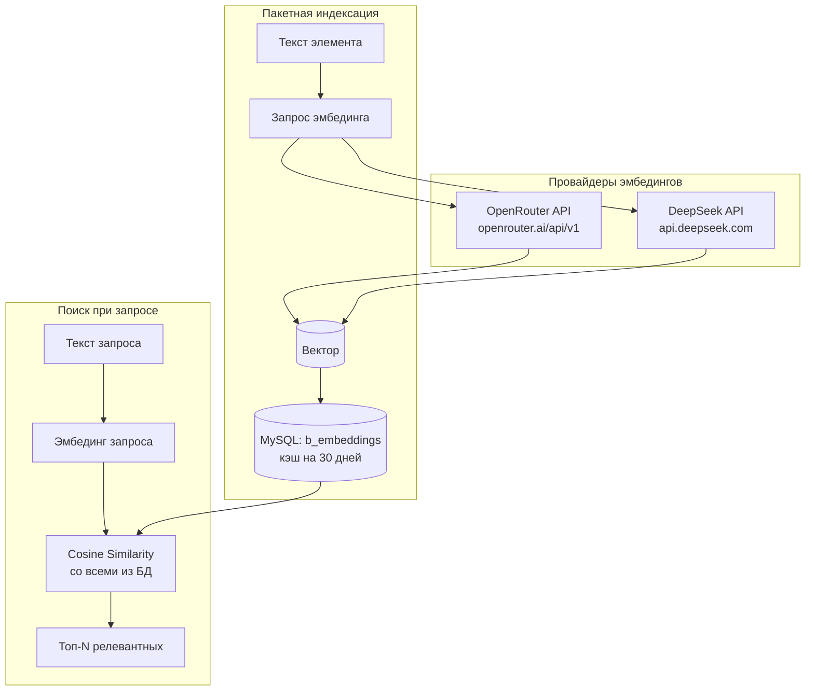
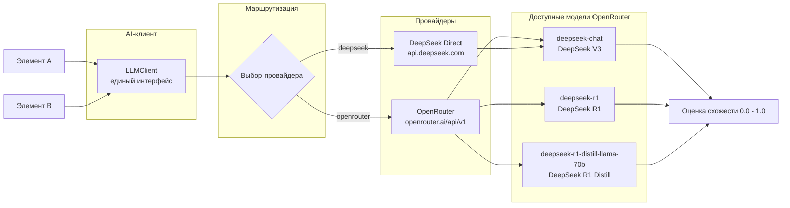
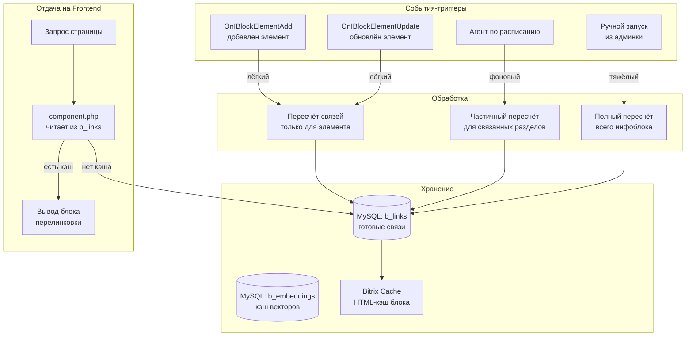
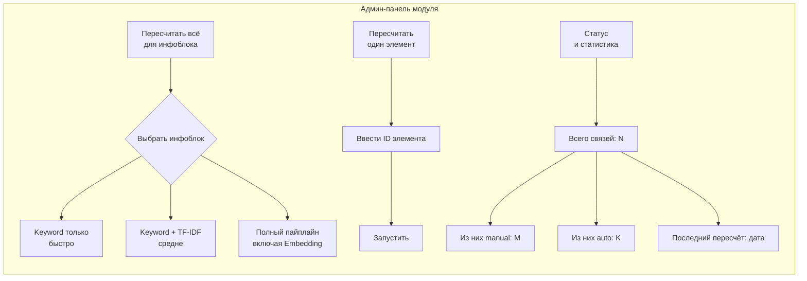
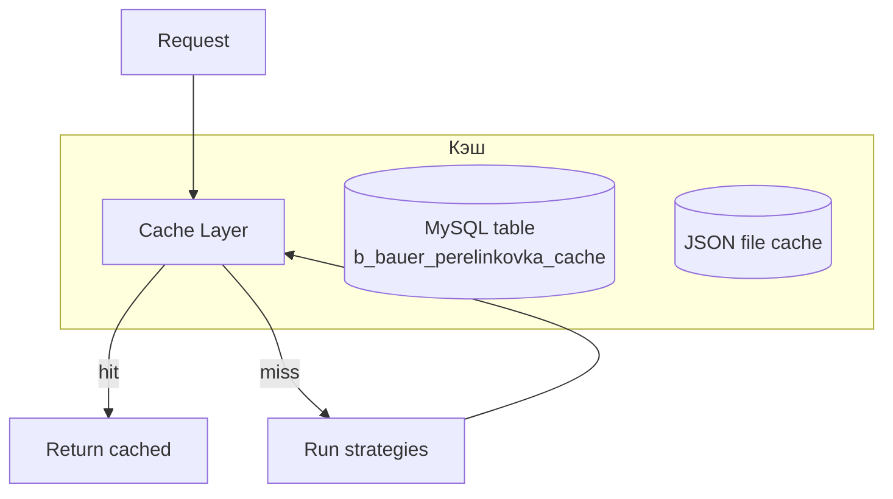
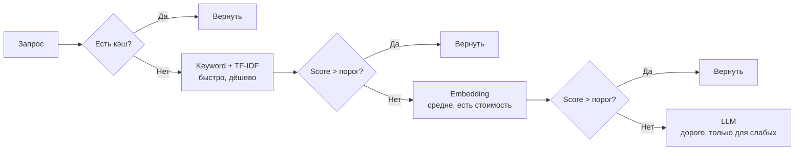

# Архитектура алгоритмов перелинковки

## Многослойная система стратегий

Предлагаю реализовать плагинную архитектуру, где каждый алгоритм — это отдельная стратегия, подключаемая через общий интерфейс.



---

## 1. Интерфейс стратегии

```php
interface MatchingStrategyInterface
{
    /** @return string уникальное имя стратегии */
    public function getName(): string;

    /** @return string описание для админки */
    public function getDescription(): string;

    /**
     * Рассчитывает оценку схожести двух сущностей
     * @param array $entityA - данные сущности A (элемент/раздел)
     * @param array $entityB - данные сущности B
     * @return float от 0.0 (не релевантно) до 1.0 (максимально релевантно)
     */
    public function calculate(array $entityA, array $entityB): float;

    /** @return float вес стратегии в итоговой оценке (0.0 - 1.0) */
    public function getWeight(): float;

    /** @return bool доступна ли стратегия (проверка зависимостей) */
    public function isAvailable(): bool;
}
```

---

## 2. Уровни алгоритмов (от простого к сложному)

### Уровень 0: Базовый (уже реализован)
**Класс:** `KeywordMatchingStrategy`

| Параметр | Вес | Описание |
|----------|-----|----------|
| Совпадение ключевых слов | 0.3 | Прямое совпадение keywords[] |
| Совпадение в заголовке | 0.2 | Общие слова в name |
| Совпадение в описании | 0.1 | Общие слова в description |
| Один раздел | 0.15 | Элементы из одного раздела |
| Один бренд | 0.25 | Apple→iPhone, Samsung→Galaxy |

**Плюсы:** Не требует внешних сервисов, быстрый  
**Минусы:** Не понимает синонимы, семантику

---

### Уровень 1: TF-IDF + Cosine Similarity
**Класс:** `TfIdfStrategy`



**Как работает:**
1. Собираем все тексты (name + description) в корпус
2. Строим TF-IDF матрицу
3. Для каждой пары считаем косинусную близость
4. Чем ближе к 1.0 — тем релевантнее

**Плюсы:** Понимает важность слов, не требует API  
**Минусы:** Не понимает синонимы, нужна предобработка

---

### Уровень 2: Embeddings через OpenRouter
**Класс:** `EmbeddingStrategy`



**Конфигурация:**
```php
[
    'provider' => 'openrouter',       // openrouter | deepseek
    'model' => 'text-embedding-3-small', // через OpenRouter
    // или 'model' => 'deepseek-chat' // через DeepSeek
    'api_key' => '{key}',
    'base_url' => 'https://openrouter.ai/api/v1',
    // или 'base_url' => 'https://api.deepseek.com',
    'batch_size' => 20,
    'cache_ttl' => 86400 * 30,
]
```

**Поддержка OpenRouter для эмбедингов:**
OpenRouter предоставляет универсальный API к множеству моделей эмбедингов от разных провайдеров. Формат запроса — OpenAI-совместимый:

```php
POST https://openrouter.ai/api/v1/embeddings
{
    "model": "text-embedding-3-small",  // или любая другая модель
    "input": "Текст товара или раздела"
}
```

**Плюсы:** Можно выбрать любой эмбединг от разных провайдеров, единый API
**Минусы:** Зависит от внешнего API, есть задержка

---

### Уровень 3: LLM-анализ через OpenRouter + DeepSeek
**Класс:** `LLMMatchingStrategy`



**Пример промпта (OpenAI-совместимый формат):**
```php
$response = $client->chat([
    'model' => 'deepseek-chat',  // DeepSeek V3 через OpenRouter
    'messages' => [
        [
            'role' => 'system',
            'content' => 'Ты SEO-специалист. Определи релевантность между товаром A и товаром B в контексте интернет-магазина. Ответь только JSON: {"score": 0.0-1.0, "reason": "..."}'
        ],
        [
            'role' => 'user',
            'content' => "A: iPhone 15 Pro - флагманский смартфон Apple\nB: Чехол-книжка для iPhone 15 Pro"
        ]
    ],
    'temperature' => 0.1,  // минимум творчества
    'max_tokens' => 150,
]);
```

**Плюсы OpenRouter:**
- Единый API для ~100+ моделей
- Можно переключаться между провайдерами без смены кода
- Fallback: если одна модель недоступна — OpenRouter сам переключит
- Поддержка DeepSeek, OpenAI, Anthropic, Google и других

**Плюсы прямого DeepSeek:**
- Не зависит от стороннего сервиса
- Часто дешевле
- Меньше задержка

---

### AI-клиент: единый интерфейс для всех API

```php
interface AiClientInterface
{
    /**
     * Получить эмбединг для текста
     * @param string $text
     * @return array вектор чисел float
     */
    public function getEmbedding(string $text): array;

    /**
     * Получить эмбединги для нескольких текстов (batch)
     * @param array $texts
     * @return array массив векторов
     */
    public function getEmbeddings(array $texts): array;

    /**
     * Отправить chat completion запрос
     * @param array $messages
     * @param array $options
     * @return array ответ с score/reason
     */
    public function chat(array $messages, array $options = []): array;
}
```

**Реализации:**

| Класс | Провайдер | Base URL | Требуется |
|-------|-----------|----------|-----------|
| `OpenRouterClient` | OpenRouter | `https://openrouter.ai/api/v1` | API-ключ OpenRouter |
| `DeepSeekClient` | DeepSeek напрямую | `https://api.deepseek.com` | API-ключ DeepSeek |

Оба используют OpenAI-совместимый формат, код почти идентичен — разница только в URL.

**Настройка в админке модуля:**
```
Провайдер: [OpenRouter | DeepSeek]
Base URL:  [https://openrouter.ai/api/v1 | https://api.deepseek.com]
API Key:   [_____________________________]
Модель для LLM: [deepseek-chat | deepseek-r1 | ...]
Модель для эмбедингов: [text-embedding-3-small | ...]
```

---

## 3.1. Композитная стратегия (CompositeStrategy)

Объединяет все стратегии с настраиваемыми весами через AiClient:

```php
// OpenRouter или DeepSeek
$client = new OpenRouterClient([
    'api_key' => 'sk-or-...',
    'base_url' => 'https://openrouter.ai/api/v1',
]);

$composite = new CompositeStrategy([
    'keyword'   => new KeywordMatchingStrategy(weight: 0.15),
    'tfidf'     => new TfIdfStrategy(weight: 0.25),
    'embedding' => new EmbeddingStrategy(weight: 0.35, [
        'ai_client' => $client,
        'model' => 'text-embedding-3-small',
    ]),
    'llm'       => new LLMMatchingStrategy(weight: 0.25, [
        'ai_client' => $client,
        'model' => 'deepseek-chat',
        'temperature' => 0.1,
    ]),
]);

$score = $composite->calculate($entityA, $entityB);
// 0.15*kw + 0.25*tfidf + 0.35*emb + 0.25*llm
```

---

## 4. Режимы работы: когда и как запускается перелинковка

### 4.1. Схема жизненного цикла



### 4.2. Режим 1: По событиям (On-the-fly при сохранении)

**Когда:** Срабатывает на события `OnIBlockElementAdd` и `OnIBlockElementUpdate` в Битрикс

**Что делает:**
1. Получает ID сохранённого элемента
2. Запускает только быстрые стратегии (Keyword + TF-IDF)
3. Находит топ-10 релевантных элементов
4. Сохраняет связи в таблицу `b_bauer_perelinkovka_links`
5. Сбрасывает кэш компонента для этой страницы

**Код в `include.php` модуля:**
```php
// Регистрация обработчика события
\Bitrix\Main\EventManager::getInstance()->addEventHandler(
    'iblock',
    'OnAfterIBlockElementAdd',
    ['\Bauer\Perelinkovka\EventHandler', 'onElementSave']
);
\Bitrix\Main\EventManager::getInstance()->addEventHandler(
    'iblock',
    'OnAfterIBlockElementUpdate',
    ['\Bauer\Perelinkovka\EventHandler', 'onElementSave']
);
```

**Ограничение:** Только быстрые алгоритмы (без эмбедингов и LLM), чтобы не замедлять админку.

---

### 4.3. Режим 2: Агент Битрикс (периодический)

**Когда:** Запускается по расписанию через агента Битрикс

**Что делает:**
1. Проверяет, какие элементы изменились с прошлого запуска
2. Запускает полный пайплайн (включая эмбединги)
3. Работает порционно — по 20-50 элементов за шаг
4. Агент сам себя перезапускает, пока все не обработает

**Регистрация агента в `install/index.php`:**
```php
// Добавляем агента при установке модуля
\CAgent::AddAgent(
    "\\Bauer\\Perelinkovka\\Agent::runFullRecalculation();",
    "bauer.perelinkovka",
    "N",
    86400, // раз в сутки
    "",
    "Y"
);
```

**Пример класса агента:**
```php
class Agent
{
    public static function runFullRecalculation(): string
    {
        $processor = new BatchProcessor();
        $processed = $processor->processNextBatch(50); // 50 за шаг
        
        if ($processor->hasMore()) {
            // Агент перезапускается, пока не обработает всё
            return "\\Bauer\\Perelinkovka\\Agent::runFullRecalculation();";
        }
        
        // Всё обработано, следующий запуск через сутки
        return "\\Bauer\\Perelinkovka\\Agent::runFullRecalculation();";
    }
}
```

---

### 4.4. Режим 3: Ленивая загрузка (Lazy loading на Frontend)

**Когда:** При запросе страницы, если связей нет или они устарели

**Что делает:**
1. Пользователь заходит на страницу товара
2. Компонент ищет связи в таблице `b_links`
3. Если связей нет — запускает быстрый расчёт Keyword + TF-IDF
4. Результат кэшируется в `bitrix/cache/`

**Пример в `component.php`:**
```php
class PerelinkovkaComponent extends \CBitrixComponent
{
    public function executeComponent()
    {
        $cache = new \CPHPCache();
        $cacheKey = 'perelinkovka_' . $this->arParams['ELEMENT_ID'];
        
        if ($cache->InitCache(3600, $cacheKey)) {
            $this->arResult = $cache->GetVars();
        } else {
            $linker = new \Bauer\Perelinkovka\Linker($dataProvider);
            $this->arResult['ITEMS'] = $linker->getLinkedEntities(
                'element',
                $this->arParams['ELEMENT_ID'],
                5
            );
            $cache->StartDataCache();
            $cache->EndDataCache($this->arResult);
        }
        
        $this->includeComponentTemplate();
    }
}
```

---

### 4.5. Режим 4: Ручной запуск из админки

**Когда:** Администратор нажал кнопку "Пересчитать связи" в административном интерфейсе

**Интерфейс в админке:**


---

### 4.6. Сводная таблица режимов

| Режим | Триггер | Скорость | Алгоритмы | Когда используют |
|-------|---------|----------|-----------|-----------------|
| **По событиям** | Сохранение элемента | Быстро | Keyword + TF-IDF | Сразу после создания товара |
| **Агент** | Раз в N часов/дней | Медленно | Все, включая Embedding | Ночью, когда сайт не грузят |
| **Ленивый** | Запрос страницы | Мгновенно | Только чтение из БД | При каждом заходе на страницу |
| **Ручной** | Кнопка в админке | Любая | На выбор администратора | После массового импорта товаров |

---

## 5. Оптимизации для Битрикс

### Кэширование результатов



### Пакетная обработка

- **При сохранении элемента** — пересчитываем связи только для него
- **CRON agent** — раз в сутки полный пересчёт для всех элементов
- **Постраничная индексация** — по 50 элементов за шаг (чтобы не убить БД)

### Гибридный pipeline для speed/cost balance



---

## 5. План реализации для модуля

### Этап 1: Базовое (без внешних API)
1. ✅ `KeywordMatchingStrategy` — готово
2. 🔲 `TfIdfStrategy` — чистый PHP
3. 🔲 `CompositeStrategy` — объединение стратегий
4. 🔲 `Event Handler` — обработка событий OnAfterIBlockElementAdd/Update
5. 🔲 `Agent` — фоновый пересчёт связей

### Этап 2: AI-интеграция OpenRouter + DeepSeek
6. 🔲 `AiClientInterface` — интерфейс AI-клиента
7. 🔲 `OpenRouterClient` — реализация через OpenRouter API
   - Эмбединги: text-embedding-3-small и другие модели
   - LLM: deepseek-chat, deepseek-r1, deepseek-r1-distill
8. 🔲 `DeepSeekClient` — реализация через прямой DeepSeek API
   - Только LLM: deepseek-chat
9. 🔲 `EmbeddingStrategy` — поиск по семантическим векторам
10. 🔲 `LLMMatchingStrategy` — LLM-анализ релевантности

### Этап 3: БД и кэширование
11. 🔲 Таблица b_bauer_perelinkovka_links — хранение связей
12. 🔲 Таблица b_bauer_perelinkovka_embeddings — кэш векторов
13. 🔲 Пакетная обработка по 50 элементов (для агента)

### Этап 4: Админка и компонент вывода
14. 🔲 Страница настроек: выбор провайдера, API-ключи, модели
15. 🔲 Страница ручного управления: пересчёт, статистика
16. 🔲 `component.php` + `template.php` — блок перелинковки на сайте

---

## 6. Схема таблиц БД для хранения

```sql
-- Связи между элементами/разделами
CREATE TABLE b_bauer_perelinkovka_links (
    id INT AUTO_INCREMENT PRIMARY KEY,
    source_type ENUM('element','section'),
    source_id INT,
    target_type ENUM('element','section'),
    target_id INT,
    source_iblock_id INT,
    target_iblock_id INT,
    strategy VARCHAR(50),        -- какая стратегия создала
    score DECIMAL(5,4),          -- итоговая оценка 0.0000 - 1.0000
    type VARCHAR(20),            -- strong/medium/weak/manual
    sort INT DEFAULT 500,
    active CHAR(1) DEFAULT 'Y',
    created_at DATETIME,
    UNIQUE KEY unique_link (source_type, source_id, target_type, target_id)
);

-- Кэш эмбедингов
CREATE TABLE b_bauer_perelinkovka_embeddings (
    entity_type ENUM('element','section'),
    entity_id INT,
    model VARCHAR(50),           -- text-embedding-3-small
    vector BLOB,                 -- numpy array двоичным
    created_at DATETIME,
    PRIMARY KEY (entity_type, entity_id, model)
);
```
